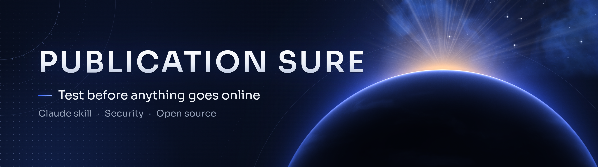

<p align="center">
  
</p>

<p align="center">
  
  
  
</p>

# publication-sure — Publication Sure

**La porte de sortie d'un site ou d'une app : elle teste vraiment, dit ce qu'elle n'a pas pu tester, et bloque la mise en ligne tant qu'un point reste ouvert.**
*A real pre-launch gate for sites and apps: it tests, then says PASS or FAIL.*

## ✦ Ce que fait le skill

| | |
|---|---|
| **Sécurité** | Clés secrètes dans le code, le build et l'historique git, `.env` et `.git` exposés, paquets inventés, en-têtes, cookies, CORS, sondes locales (XSS, admin ouvert, limite de tentatives). |
| **Légal FR/UE** | Mentions légales, RGPD, cookies, CGV, rétractation, médiateur. |
| **Qualité** | Lighthouse mobile et ordinateur, liens cassés, checklist de lancement, audit SEO. |
| **Verdict** | PRÊT À PUBLIER, À CORRIGER ou BLOQUÉ, chaque point avec sa preuve ; ce qui n'a pas pu être testé est écrit. |

## ✦ Installation

**Télécharger** : bouton vert **Code → Download ZIP**, ou :

```bash
git clone https://github.com/horizonchapter/publication-sure.git
```

**Claude Code** (pour tous tes projets) :

```bash
cp -r publication-sure/skills/publication-sure ~/.claude/skills/
```

**Claude (app et web)** : importe le fichier [`publication-sure.zip`](publication-sure.zip) dans les réglages des skills de Claude.

## ✦ Utilisation

- « Je peux mettre le site en ligne ? »
- `python skills/publication-sure/scripts/scan_securite.py <source> --dist <build> --rapport securite.md`

## ✦ Prérequis et limites

Scripts en Python 3, sans dépendance. Le contrôle Lighthouse s'appuie sur `npx lighthouse` et `npx linkinator` (le script maison de l'auteur n'est pas fourni). Un pentest Strix ou un audit security-audit complet se lance à part : ce skill dit quand il s'impose. Les contrôles légaux visent la France et l'Union européenne et ne remplacent pas un avis juridique.

## ✦ Crédits et licences

Les skills Strix (Apache-2.0) et security-audit sont **appelés, jamais recopiés** : aucun de leurs textes n'est dans ce dépôt.

## ✦ Structure

```
publication-sure/
├── skills/publication-sure/
│   ├── SKILL.md
│   ├── CHANGELOG.md
│   ├── references/checklist-lancement.md
│   └── scripts/            scan_securite.py, sondes_site.py, controle_legal.py
├── publication-sure.zip
└── assets/             bannière
```

## ✦ Voir aussi

[design-horizon](https://github.com/horizonchapter/design-horizon) · [memoire-relais](https://github.com/horizonchapter/memoire-relais) · [pdf-sobre](https://github.com/horizonchapter/pdf-sobre) · [decision-business](https://github.com/horizonchapter/decision-business) · [skill-booster](https://github.com/horizonchapter/skill-booster) · [clearmind](https://github.com/horizonchapter/clearmind)

## ✦ Licence

[MIT](LICENSE). Historique des versions : [CHANGELOG](CHANGELOG.md).
